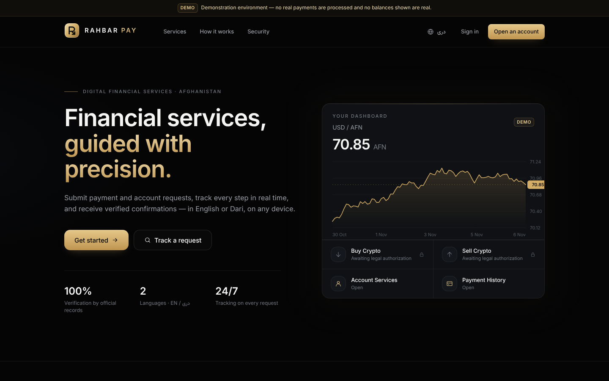
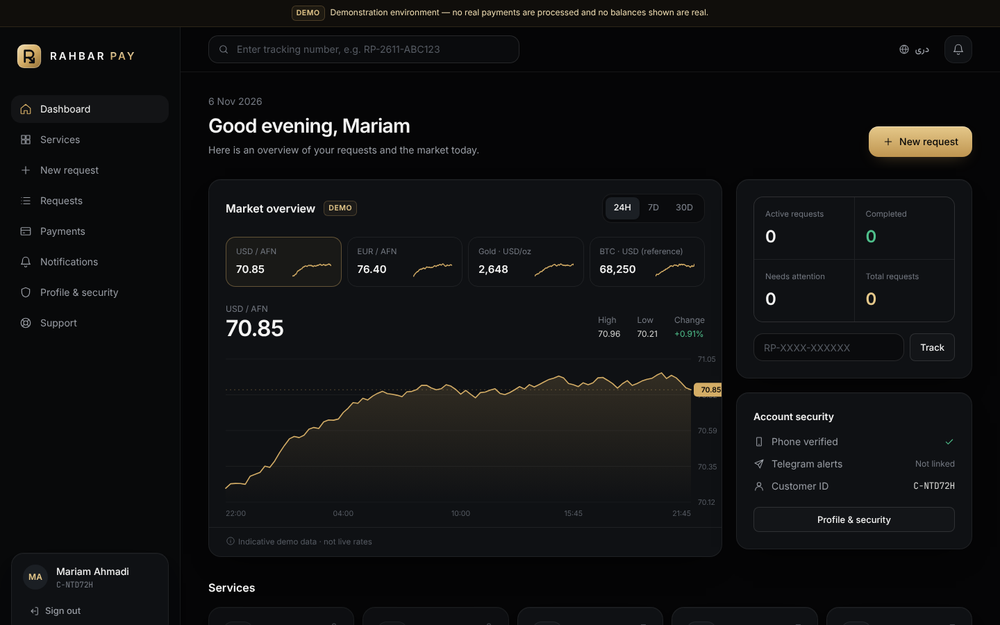
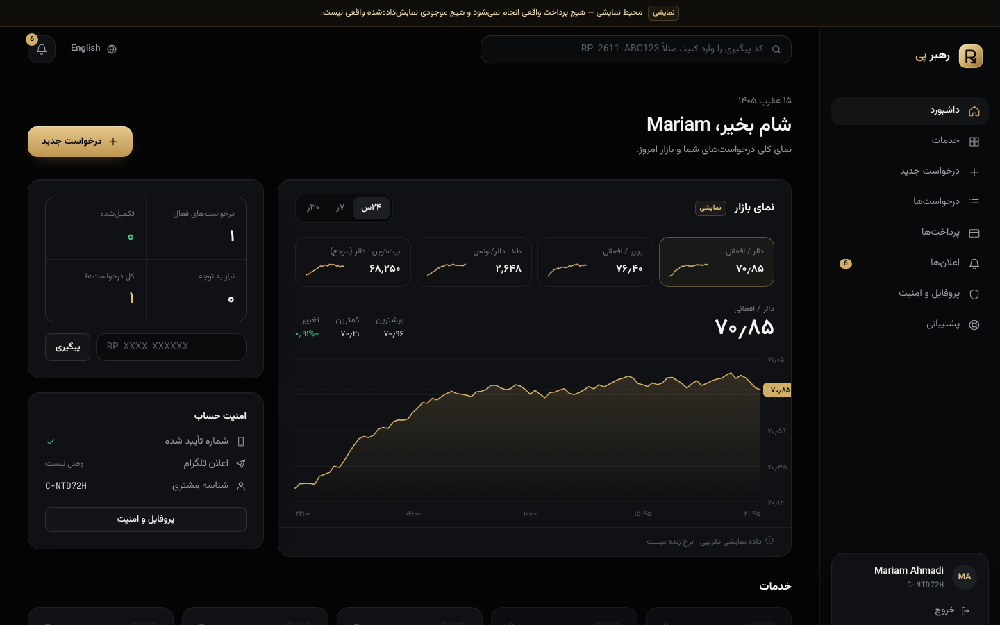
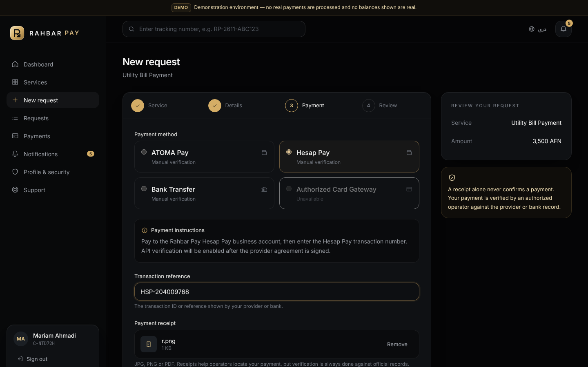
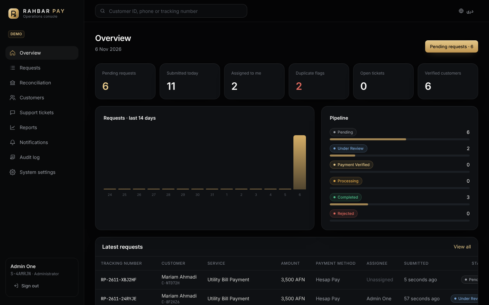
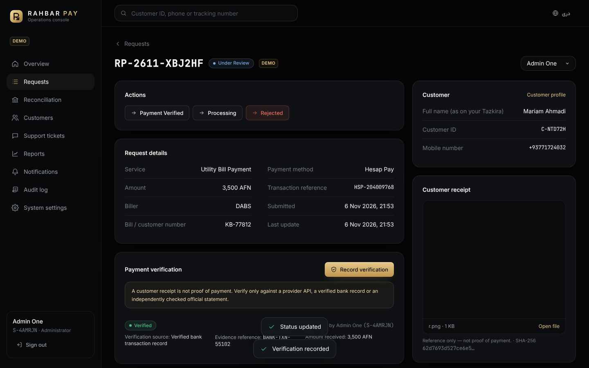

# Rahbar Pay — رهبر پی

A digital financial services web app (working prototype). Customers submit payment and account requests, pay through an available method, and track each request with a tracking number. Operators check payments against official records in a separate admin console that requires two-factor sign-in.

> **Demo environment.** No real payments are processed. Every request is marked *demo*, market charts use sample data labelled as such, and no balances are shown. Do not connect real payment accounts, and do not enable crypto services, until you hold the required legal and provider authorization.

- **Languages:** English (default, left-to-right) and Dari (right-to-left). The switch is in every header. Dari dates use the Afghan solar calendar.
- **Currencies:** AFN and USD.
- **Stack:** HTML5, Tailwind CSS v4 and plain JavaScript modules (no framework). The backend is a Cloudflare Worker with a D1 database. Receipts can be stored in R2, and notifications can go through the Telegram Bot API.

## Pages

| Customer (`/`) | Admin (`/admin`) |
|---|---|
| Landing `/` | Admin login + 2FA `/admin/login` (first admin: `/admin/setup`) |
| Login `/login` · Registration `/register` · Password reset `/forgot` | Overview `/admin` |
| Dashboard `/dashboard` | Customer management `/admin/customers` |
| Service catalog `/services` | Request management `/admin/requests` |
| Request submission `/requests/new` | Payment reconciliation `/admin/reconciliation` |
| Request tracking `/requests` · `/requests/RP-…` | Reports (daily / monthly + CSV) `/admin/reports` |
| Payment history `/payments` | Support tickets `/admin/support` |
| Notifications `/notifications` | Notifications (broadcast) `/admin/notifications` |
| Profile & security `/profile` | Audit log `/admin/audit` |
| Support center `/support` | System settings `/admin/settings` |

## Payment methods

| Method | Status in the prototype |
|---|---|
| **ATOMA Pay** | Manual verification (API after the provider agreement) |
| **Hesap Pay (حساب پی)** | Manual verification (API after the provider agreement) |
| **Bank transfer** | Manual verification, company account only |
| **Authorized card gateway** | Disabled until a gateway is integrated |

An admin can switch each method between *manual* and *disabled* under **System settings → Payment methods**. The *API* status only becomes available once a real provider integration is deployed.

## Rules the server enforces

- **Payment Verified needs an independent record.** A request can only move to *Payment Verified* (or to *Processing*, for paid services) once an operator has recorded a verification from one of three sources: a provider API, a verified bank transaction record, or an independently checked official statement. The operator must also confirm it was checked independently of the customer's receipt. A receipt upload never verifies a payment.
- **Verified amount must match.** The verified amount has to equal the requested amount. If it doesn't, the operator records a *mismatch* instead.
- **Duplicate transaction detection.**
  - The same customer can't reuse a payment reference. References are compared after normalizing case and punctuation.
  - If a different customer submits the same reference, the request is accepted but flagged for operators.
  - A reference can only be *verified* once (enforced by a unique database index).
- **Status order:** Pending → Under Review → Payment Verified → Processing → Completed. A request can be Rejected at any step, and a rejection needs a reason that the customer sees.
- **Crypto services:** Buy and Sell Crypto have the status `legal_pending` and can't receive requests. An admin can activate them only after explicitly confirming that legal authorization was obtained, and that confirmation is written to the audit log.
- **Audit log:** every admin action is recorded with the operator ID, timestamp, IP address and details. This covers status changes, verifications, notes, assignments, views of customers and files, settings, staff, reports and announcements.
- **Roles:** customers, operators and admins.
  - Only admins can change settings, services, payment methods or staff, suspend customers, or broadcast announcements.
  - Admin functions are never sent to customer sessions. The two use separate cookies, and the staff cookie is limited to the path `/api/admin`.
- **Telegram:** messages contain only a status line, never amounts, names, account details or tracking numbers.

## Security

- **Passwords:** hashed with PBKDF2-SHA256 (100k iterations, a salt per user).
- **Sessions:** random tokens in an HttpOnly, Secure, SameSite=Strict cookie. Only the SHA-256 of each token is stored. Customer sessions last 7 days and staff sessions 8 hours.
- **Phone verification and password reset:** 6-digit one-time codes, stored hashed, valid for 10 minutes, with at most 5 attempts.
- **Staff two-factor authentication:** TOTP (RFC 6238), set up at first sign-in. An admin can reset another staff member's 2FA.
- **Rate limits:** on registration, login, codes, submissions, uploads and tickets.
- **Account lockout:** 15 minutes after 5 failed customer logins, 30 minutes for staff.
- **CSRF protection:** an Origin check on every POST/PATCH request, plus SameSite=Strict cookies.
- **Uploads:** JPG, PNG or PDF only, checked by file signature (magic bytes). Files are served only to their owner or to staff, with `nosniff` and a sandbox CSP.
- **Response headers:** strict CSP (scripts from the site only), HSTS, `frame-ancestors 'none'`, a referrer policy and a permissions policy.
- **Input handling:** every value is validated on the server, and all SQL is parameterized.
- **Output escaping:** HTML is escaped by a tagged-template helper (`public/assets/js/core/html.js`).

## Project layout

```
rahbar-pay/
├── wrangler.toml            Worker, static assets, D1 and (optional) R2 configuration
├── migrations/0001_init.sql Schema + seed services and payment methods
├── src/
│   ├── worker.js            Router, security headers, Telegram webhook, cron cleanup
│   ├── lib/util.js          Validation, IDs, PBKDF2, TOTP
│   ├── lib/auth.js          Sessions, roles, rate limits, audit log
│   ├── lib/notify.js        In-app + Telegram notifications
│   └── routes/customer.js   Public + customer API
│       routes/admin.js      Admin API
├── styles/app.css           Tailwind v4 theme (design tokens + components)
└── public/
    ├── index.html           Customer single-page app
    ├── admin.html           Admin single-page app
    └── assets/
        ├── app.css          Built CSS (committed, so a deploy needs no build step)
        ├── img/             Logo mark + wordmark (SVG)
        └── js/core|app|admin
```

To add a new service, insert a row into `services`. The `fields` JSON column defines the form fields the customer fills in, so no frontend code changes.

## Run locally

```bash
cd rahbar-pay
npm install
npx wrangler d1 migrations apply rahbar-pay --local
echo 'ADMIN_SETUP_KEY=choose-a-long-random-key' > .dev.vars
npm run dev            # builds CSS, starts http://localhost:8787
```

1. Open `/register` and create a customer. In demo mode the one-time code is shown on screen.
2. Open `/admin/setup` and create the first administrator with your `ADMIN_SETUP_KEY`.
3. Sign in at `/admin`. Add the secret key shown to an authenticator app (Google or Microsoft Authenticator) and enter the 6-digit code.

## Deploy to Cloudflare (Workers + D1)

```bash
cd rahbar-pay
npx wrangler login
npx wrangler d1 create rahbar-pay            # copy the database_id into wrangler.toml
npx wrangler d1 migrations apply rahbar-pay --remote
npx wrangler secret put ADMIN_SETUP_KEY      # long random string
npm run deploy
```

Then open `https://rahbar-pay.<your-subdomain>.workers.dev/admin/setup` once to create the first admin.

To use your own domain, add `routes = [{ pattern = "pay.example.com", custom_domain = true }]` to `wrangler.toml`.

To deploy automatically from GitHub, create a Workers Builds project in the Cloudflare dashboard with **root directory `rahbar-pay`** and deploy command `npx wrangler deploy`. The existing site at the repository root keeps its own Worker and is not affected.

### Optional: R2 storage for receipts

```bash
npx wrangler r2 bucket create rahbar-pay-files
```

Then uncomment the `[[r2_buckets]]` block in `wrangler.toml`. Without R2, receipts are stored in D1 with a 2 MB limit, which is meant for the demo only.

### Optional: Telegram notifications

1. Create a bot with @BotFather.
2. Run `npx wrangler secret put TELEGRAM_BOT_TOKEN`, then `npx wrangler secret put TELEGRAM_WEBHOOK_SECRET` with any random string.
3. Set the webhook:

   ```bash
   curl "https://api.telegram.org/bot<TOKEN>/setWebhook?url=https://<your-domain>/api/telegram/webhook&secret_token=<WEBHOOK_SECRET>"
   ```

4. Enter the bot username under **Admin → System settings → General**.
5. Customers link Telegram under **Profile → Telegram**.
6. Optional: run `npx wrangler secret put TELEGRAM_ADMIN_CHAT` to send operator alerts, which carry counts only.

### Optional: daily cleanup

Add the following to `wrangler.toml` to delete expired sessions, codes and rate-limit rows every day:

```toml
[triggers]
crons = ["17 2 * * *"]
```

### Before going live

1. Get legal authorization and sign provider agreements, for example with ATOMA Pay and Hesap Pay.
2. Connect an SMS provider in `issueOtp()` (`src/routes/customer.js`), then set `DEMO_MODE = "false"`.
3. Put the company bank account details in each payment method's instructions. Never use a personal account.
4. Build the provider API verification, which records `payments` rows with `source = 'provider_api'`, and only then allow the `api` method status.
5. Have the system security-reviewed before any real customer uses it.

## Screenshots

| | |
|---|---|
|  |  |
|  |  |
|  |  |
